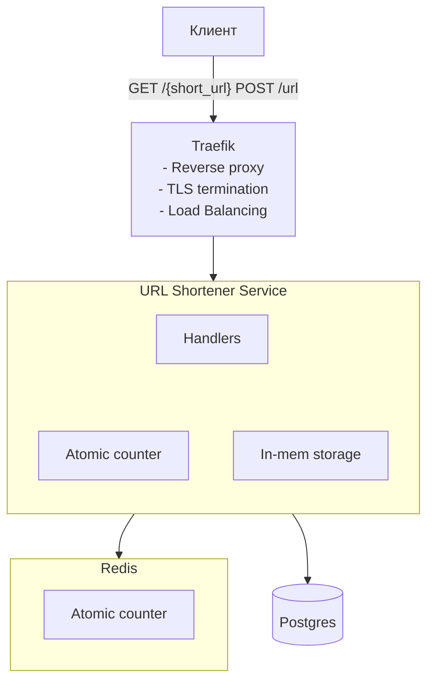

# Укорачиватель ссылок

# Требования
## 1. Функциональные требования
- Генерация уникальной [короткой ссылки](#короткая-ссылка) для длинной ссылки
- Редирект при переходе по [короткой ссылке](#короткая-ссылка) на адрес оригинальной ссылки

## 2. Нефункциональные требования
- DAU: 100 миллионов активных пользователей ежедневно
- До 1 миллиарда активных ссылок в базе данных единовременно

### Короткая ссылка
- Ссылка уникальна и на один оригинальный URL должна ссылаться только одна сокращённая ссылка
- Ссылка должна быть длинной 10 символов
- Ссылка должна состоять из символов латинского алфавита в нижнем и верхнем регистре, цифр и символа _ (подчёркивание): a-z, A-Z, 0-9, _ .

# Архитектура проекта
Для обеспечения уникальности ссылок будем использовать атомарный счётчик, который будем инкрементировать каждый раз при регистрации новой ссылки.

Само значение числовое от счётчика добивается ведущими нулями, чтобы всегда было 10 символов даже для первых ссылок, а затем кодируем это значение по аналогии как это делаестя в base64, но с нашим собственным алфавитом на 63 символа.

Таким образом мы можем обеспечить 63^10 уникальных коротких ссылок.

## Архитектурная диаграмма


- Redis: отдельно выделил счётчик, чтобы была возможность горизонтально масштабировать сервис. В дальнейшем может выполнять функцию не только счётчика, но и кэша.
- 
## API
- Создание короткой ссылки:
```json
POST /url 
{
	"url": "...",
	"ttl": "..." optional
}
```
Ответ:
```json
{
    "short_url": "..."
}
```
- Переход по короткой ссылке:
```
GET /{short_url}
```
Ответ:
```
Status: HTTP 302
```
## Схема данных
-   **id**: уникальный идентификатор ссылки UUID v7,
-   **original**: оригинальный URL,
-   **short**: сокращённая ссылка,
-   **created_at**: время создания ссылки,
-   **expires_at**: время, когда ссылка перестает быть активной (TTL).

TTL по умолчанию ставиться на 1 год.

